<picture>
  <source media="(max-width: 600px)" srcset="./assets/hero-mobile.svg">
  
</picture>

**[Написать в Telegram](https://t.me/friedfluoride)** &nbsp;·&nbsp; [Канал @friedauto](https://t.me/friedauto) &nbsp;·&nbsp; [English](#english)

Разработчик на **Python** и **C#**, беру заказы. Пишу больше пяти лет, в основном — боты и автоматизация для продавцов на FunPay, Playerok, GGSEL и Digiseller: автовыдача, управление ценами, ответы покупателям, всё из Telegram. Ещё делаю Telegram-магазины, парсеры, интеграции с API и десктоп на WPF и Avalonia.

 

## eps1.0_projects.py

<picture>
  <source media="(max-width: 600px)" srcset="./assets/projects-mobile.svg">
  
</picture>

### [Playerok Universal](https://github.com/alleexxeeyy/playerok-universal)

Помощник для продавцов на Playerok: чаты, сделки, товары, отзывы и статистика — из Telegram. Вечный онлайн, быстрые ответы, уведомления о продажах и плагины.

[Релизы](https://github.com/alleexxeeyy/playerok-universal/releases) · [Установка](https://github.com/alleexxeeyy/playerok-universal#%EF%B8%8F-установка)

### [FunPay Universal](https://github.com/alleexxeeyy/funpay-universal)

То же для FunPay: заказы, лоты, чаты, отзывы и статистика из Telegram, заменители в сообщениях, автообновление и плагины.

[Релизы](https://github.com/alleexxeeyy/funpay-universal/releases) · [Установка](https://github.com/alleexxeeyy/funpay-universal#%EF%B8%8F-установка)

### [PlayerokAPI](https://github.com/alleexxeeyy/PlayerokAPI)

Неофициальная Python-библиотека для Playerok: аккаунт, чаты, сделки, товары и слушатель событий. На ней работает Playerok Universal.

[Документация](https://playerokapi.readthedocs.io/ru/latest/)

<b>Плагины — 15 модулей для FunPay и Playerok Universal</b>

 

| Модуль | Что делает | FunPay | Playerok |
| :--- | :--- | :---: | :---: |
| `autostars` | Продажа Telegram Stars | ✓ | ✓ |
| `autopremium` | Выдача Telegram Premium через Fragment | ✓ | |
| `autotggifts` | Отправка Telegram-подарков за звёзды | ✓ | ✓ |
| `autosteamgifts` | Продажа и отправка подарков в Steam | ✓ | ✓ |
| `autosteamoffline` | Продажа оффлайн-активаций Steam | ✓ | ✓ |
| `autosteamrental` | Аренда Steam-аккаунтов | ✓ | ✓ |
| `autorobux` | Продажа Robux через GamePass | | ✓ |
| `robuxsend` | Продажа Robux переводом через Roblox Plus | ✓ | ✓ |
| `swizzyerrobux` | Выдача Robux через сервис Swizzyer | ✓ | ✓ |
| `swizzyerrobuxapp` | Выдача Robux через Swizzyer, управление в Telegram Mini App | ✓ | |
| `autoapproute` | Продажа услуг из AppRoute | ✓ | ✓ |
| `autobooster` | Продажа SMM-услуг | ✓ | |
| `autodumping` | Подстраивает цены лотов под конкурентов | ✓ | |
| `autochange` | Меняет данные аккаунта после восстановления товара | | ✓ |
| `aichat` | Отвечает покупателям с помощью ИИ | ✓ | ✓ |

Купить и подключить — [@friedshopbot](https://t.me/friedshopbot). Лицензии и выдача плагинов работают через собственный сервер FriedFries на FastAPI.

 

## eps1.1_clients.log

<picture>
  <source media="(max-width: 600px)" srcset="./assets/clients-mobile.svg">
  
</picture>

Проекты под заказ — код закрыт, поэтому без ссылок.

- **AppRoute Shop** — Telegram-магазин цифровых кодов: Valorant Points, PlayStation, Apple Gift Card и не только. Покупатель платит через Platega (СБП или крипта), бот сам закупает код у AppRoute и присылает его в чат с инструкцией. Цены пересчитываются вслед за закупочными.
- **GGSEL AutoPricer** — держит цены на GGSEL и Digiseller в актуальном состоянии: сверяется с PS Store, Xbox и Epic Games, учитывает курс ЦБ и наценку, ловит распродажи и возвращает обычную цену за 3 часа до конца скидки.
- **Kwork Auto Responder** — следит за биржей Kwork, отбирает подходящие проекты, оценивает их нейросетью, пишет и отправляет отклики. Управление — в Telegram.
- **Digiseller SteamOffline** — продаёт оффлайн-активации Steam на Digiseller: после оплаты выдаёт данные аккаунта, а свежий код Steam Guard покупатель запрашивает сам — бот отвечает автоматически.
- **Dota 2 Farm** — *в работе.* Ферма аккаунтов Dota 2 под Windows: управление окнами через Win32, без инжекта в игру.

 

## eps1.2_stack.cfg

<picture>
  <source media="(max-width: 600px)" srcset="./assets/stack-mobile.svg">
  
</picture>

<b>Подробнее о стеке</b>

 

| Область | Инструменты |
| :--- | :--- |
| Python | asyncio, FastAPI, aiogram 3, httpx, aiohttp, requests, pydantic |
| C# | .NET, WPF, Avalonia |
| Telegram | боты, магазины, панели управления, Mini Apps |
| Данные | SQLite, MySQL |
| Сеть и парсинг | curl-cffi, tls-requests, websocket-client, BeautifulSoup, lxml |
| Нейросети | DeepSeek, OpenAI, Gemini, OpenRouter |
| Площадки и API | FunPay, Playerok, GGSEL, Digiseller, Kwork, Steam, Fragment, AppRoute, Platega |
| Деплой | Linux, systemd, Docker |

 

## eps1.3_connect.sh

Опиши задачу в Telegram — скажу, сколько это займёт и сколько будет стоить.

<a href="https://t.me/friedfluoride">
  <picture>
    <source media="(max-width: 600px)" srcset="./assets/connect-mobile.svg">
    
  </picture>
</a>

Канал с обновлениями — [@friedauto](https://t.me/friedauto) · Магазин плагинов — [@friedshopbot](https://t.me/friedshopbot)

 

<b>English</b>

 

I'm a **Python** and **C#** developer with 5+ years of experience. I mostly build bots and automation for sellers on FunPay, Playerok, GGSEL and Digiseller: auto-delivery, pricing, buyer replies, all managed from Telegram. I also make Telegram stores, scrapers, API integrations and desktop apps with WPF and Avalonia.

Open to freelance work — **[@friedfluoride](https://t.me/friedfluoride)** on Telegram.

**Open source**

- **[Playerok Universal](https://github.com/alleexxeeyy/playerok-universal)** — assistant bot for Playerok sellers: chats, deals, items, reviews and stats from Telegram, 24/7 online status, quick replies and plugins.
- **[FunPay Universal](https://github.com/alleexxeeyy/funpay-universal)** — the same toolkit for FunPay: orders, listings, chats, reviews, stats, auto-updates and plugins.
- **[PlayerokAPI](https://github.com/alleexxeeyy/PlayerokAPI)** — unofficial Python library for Playerok; it powers Playerok Universal.
- **15 plugins** for both bots — Telegram Stars and Premium, Steam gifts and rentals, Robux, AI chat and more. Sold through [@friedshopbot](https://t.me/friedshopbot).

**Client work** — private code

- **AppRoute Shop** — Telegram store for digital codes: payments via Platega, codes are purchased from AppRoute automatically.
- **GGSEL AutoPricer** — keeps GGSEL and Digiseller prices in sync with PS Store, Xbox and Epic Games.
- **Kwork Auto Responder** — scans Kwork, rates projects with AI and sends proposals.
- **Digiseller SteamOffline** — sells Steam offline activations on Digiseller and sends Steam Guard codes on request.
- **Dota 2 Farm** — *in progress:* a Dota 2 account farm for Windows that controls game windows via Win32, with no injection into the game.

**Stack:** Python (asyncio, FastAPI, aiogram 3, httpx, aiohttp), C# (.NET, WPF, Avalonia), SQLite, MySQL, DeepSeek / OpenAI / Gemini, Linux, Docker.

Got a task? Message me on Telegram, describe what you want automated, and I'll tell you the timeline and price.

